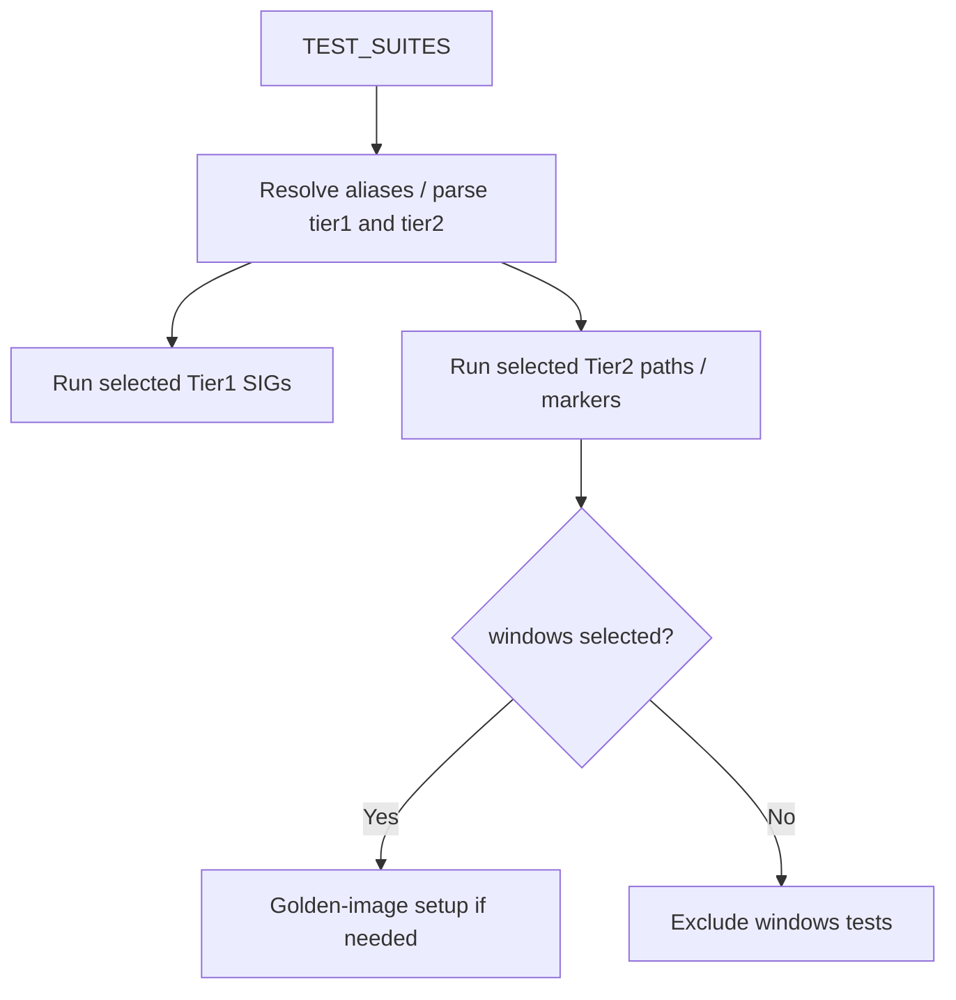

# Test Suites Filtering Redesign

<table>
<tr><td><b>Author</b></td><td>Ahmad Hafe</td></tr>
<tr><td><b>Status</b></td><td>In Progress</td></tr>
<tr><td><b>Feature PR</b></td><td>TBD</td></tr>
<tr><td><b>Bug</b></td><td><a href="https://redhat.atlassian.net/browse/CNV-100623">CNV-100623</a></td></tr>
</table>

---

## Summary

Redesign `TEST_SUITES` so users pick coverage by **tier** and **SIG**, instead of a flat list where `storage` means only KubeVirt Tier-1 and `tier2` is one opaque blob.

## Motivation

`TEST_SUITES=storage` runs only KubeVirt Tier-1 storage tests. It does not run openshift-virtualization-tests storage coverage. Windows is also not a suite — it is a side effect of golden-image availability inside `tier2`.

### User Stories

As a storage partner, I want to choose Tier-1 storage, Tier-2 storage, or both.

As a partner validating Windows, I want a dedicated Windows suite filter without taking the entire Tier-2 blob.

## Goals

- Tier1 / Tier2 selection, each with SIG-level granularity
- Tier2 mapped to OVT module paths; Windows as a first-class filter
- Backward-compatible aliases for today’s flat values
- Docs that show which repo and filter each suite runs

---

## How It Works

New syntax: `TEST_SUITES=tier1/<sig>,tier2/<sig>,...`

```text
Tier1                                   Tier2
├── compute  → kubevirt sig-compute     ├── compute         → tests/virt/
├── network  → kubevirt sig-network     ├── storage         → tests/storage/
├── storage  → kubevirt sig-storage     ├── network         → tests/network/
└── ssp      → ssp-operator             ├── infrastructure  → tests/infrastructure/
                                        └── windows         → conformance + windows
                                                              (golden-image gated)
```

Examples:

```bash
TEST_SUITES=tier1/storage                         # same as today’s storage
TEST_SUITES=tier1/storage,tier2/storage           # both repos
TEST_SUITES=tier2/windows                         # Windows only
```



---

## Backward Compatibility

Old values keep working and keep today’s meaning:

| Legacy value | Resolves to |
|--------------|-------------|
| `compute` / `network` / `storage` / `ssp` | `tier1/<same>` |
| `tier2` | all Tier2 SIGs |
| default `compute,network,storage,ssp,tier2` | same coverage as today |

`storage` stays Tier-1 only. Full storage coverage is opt-in: `tier1/storage,tier2/storage`.

Windows exists only under Tier-2. `ACCEPT_WINDOWS_EULA=true` (UI Accept EULA) always adds `tier2/windows`.

---

## Risks and Mitigations

| Risk | Mitigation |
|------|------------|
| Existing jobs use flat suite names | Keep aliases; warn that bare `storage` is Tier-1 only |
| OVT module paths change | One mapping table; fail clearly if a path is missing |
| `tier2/windows` without golden image | Same as today: skip with a clear message, or require EULA / BYOI |

---

## Related

- Bug: [CNV-100623](https://redhat.atlassian.net/browse/CNV-100623)
- Code: `scripts/entrypoint.sh`, `scripts/tier2/test-tier2.sh`, `manifests/run/generate.sh`
