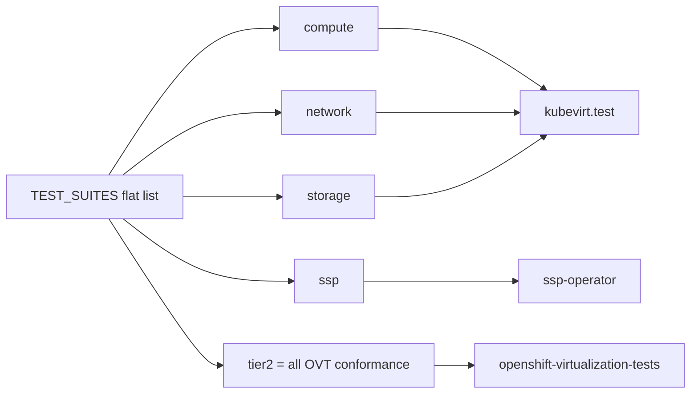
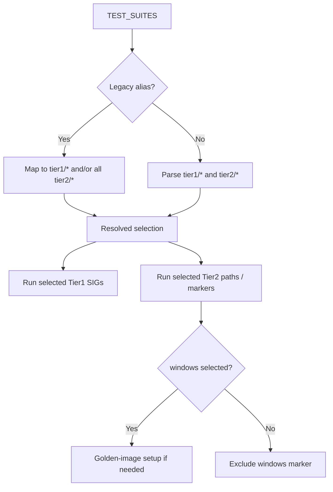

# Test Suites Filtering Redesign

<table>
<tr><td><b>Author</b></td><td>Ahmad Hafe</td></tr>
<tr><td><b>Status</b></td><td>Draft</td></tr>
<tr><td><b>Feature PR</b></td><td>TBD</td></tr>
<tr><td><b>Bug</b></td><td><a href="https://redhat.atlassian.net/browse/CNV-100623">CNV-100623</a></td></tr>
</table>

---

## Summary

Redesign `TEST_SUITES` so users select coverage by **tier** and **SIG**, instead of a flat list that mixes KubeVirt Tier-1 SIGs with a single opaque `tier2` blob.

After this change, partners can run Tier-1 storage, Tier-2 storage, Windows, or any combination, with documentation that clearly states which repository and filters each selection runs.

## Motivation

Today `TEST_SUITES=storage` only runs KubeVirt Tier-1 storage tests (`sig-storage&&conformance` / `StorageCritical`). It does **not** run RedHatQE/openshift-virtualization-tests storage coverage. Windows coverage is also not a dedicated suite — it is a side effect of golden-image availability inside the monolithic `tier2` suite.

That makes suite names misleading for storage partners and anyone who expects SIG-named suites to mean “all relevant coverage for that area.”

### User Stories

As a storage partner, I want `storage` selection to be explicit about Tier-1 vs Tier-2 so I can run KubeVirt storage, OVT storage, or both.

As a partner validating Windows support, I want a dedicated Windows suite filter so I can enable Windows tests without taking the entire Tier-2 blob.

As a user of the self-validation tool, I want the README to show which repo and which filter each suite runs, so I am not surprised by what executes.

## Goals

- Hierarchical suite selection: **Tier1** and **Tier2**, each with SIG-level granularity
- Tier-2 selection mapped to openshift-virtualization-tests **module paths** (plus Windows as a marker-based filter)
- Backward-compatible aliases for today’s flat `TEST_SUITES` values
- Clear documentation of repo + filter per suite

## Non-Goals

- Changing which individual tests are marked `conformance` upstream
- Replacing `TEST_FOCUS` / `TEST_SKIPS`
- Changing golden-image creation mechanics (only when Windows suite setup is triggered)

---

## Current Behaviour

| `TEST_SUITES` value | What runs today |
|---------------------|-----------------|
| `compute` / `network` / `storage` | KubeVirt Tier-1 only (`scripts/kubevirt/test-kubevirt.sh`) |
| `ssp` | ssp-operator tests |
| `tier2` | All OVT `@pytest.mark.conformance` (`scripts/tier2/test-tier2.sh`) |
| Windows | Included only when a golden image is available; otherwise `conformance and not windows` |

Default: `compute,network,storage,ssp,tier2`.



---

## Proposed Design

### Suite hierarchy

```text
Tier1                                   Tier2
├── compute  → kubevirt sig-compute     ├── compute         → tests/virt/
├── network  → kubevirt sig-network     ├── storage         → tests/storage/
├── storage  → kubevirt sig-storage     ├── network         → tests/network/
│              (+ StorageCritical)      ├── infrastructure  → tests/infrastructure/
└── ssp      → ssp-operator             └── windows         → conformance + windows marker
                                                              (golden-image gated)
```

### New syntax

```bash
TEST_SUITES=<tier>/<sig>[,<tier>/<sig>...]
```

Examples:

```bash
# Tier-1 storage only (same coverage as today’s `storage`)
TEST_SUITES=tier1/storage

# Full storage story across both repos
TEST_SUITES=tier1/storage,tier2/storage

# Windows only
TEST_SUITES=tier2/windows

# Compute on both tiers + Tier-2 network
TEST_SUITES=tier1/compute,tier2/compute,tier2/network
```

### How it works

1. `generate.sh` validates the suite list (new grammar + legacy aliases) and embeds it on the Job.
2. `entrypoint.sh` resolves aliases into an internal selection set:
   - Tier1 SIGs → existing KubeVirt / SSP runners
   - Tier2 SIGs → one Tier-2 run with selected paths / markers
3. `test-tier2.sh` stops running “all conformance” by default when SIGs are selected; it builds pytest path args and marker expressions from the selection.
4. Windows golden-image setup runs when `tier2/windows` is selected (or when legacy `tier2` resolves to include Windows), instead of “any time `tier2` is present” only as today’s coarse gate.



### Tier-2 path mapping

| Suite | Pytest selection |
|-------|------------------|
| `tier2/compute` | `tests/virt/` + `-m conformance` |
| `tier2/storage` | `tests/storage/` + `-m conformance` |
| `tier2/network` | `tests/network/` + `-m conformance` |
| `tier2/infrastructure` | `tests/infrastructure/` + `-m conformance` |
| `tier2/windows` | `-m "conformance and windows"` (paths may span modules; requires golden image) |

Multiple Tier-2 SIGs in one Job are combined into a single pytest invocation when practical (union of paths + marker expression).

---

## Backward Compatibility

Old flat values keep working as **aliases**. They preserve today’s meaning so existing Jobs do not silently expand.

| Legacy value | Resolves to | Notes |
|--------------|-------------|-------|
| `compute` | `tier1/compute` | Unchanged coverage |
| `network` | `tier1/network` | Unchanged coverage |
| `storage` | `tier1/storage` | Still Tier-1 only — **not** both tiers |
| `ssp` | `tier1/ssp` | Unchanged coverage |
| `tier2` | all `tier2/*` SIGs | Same blob as today, including Windows when golden image exists |
| default `compute,network,storage,ssp,tier2` | same resolved set | Same total coverage as today |

Why not make legacy `storage` mean both tiers? That would fix the surprise for new users but break anyone who intentionally runs Tier-1-only storage. The redesign makes the full storage story **opt-in** via `tier1/storage,tier2/storage`, with docs and a deprecation warning for bare `storage`.

Suggested warning (non-fatal):

```text
WARNING: 'storage' maps to tier1/storage only. To include OVT storage, use tier1/storage,tier2/storage.
```

---

## Documentation Changes

Update the README Test Suites section to show the hierarchy, examples, and the legacy alias table. Each suite entry must list:

- Tier
- Source repository
- Filter (ginkgo label, pytest path, and/or marker)

---

## Implementation Touchpoints

| Area | Change |
|------|--------|
| `manifests/run/generate.sh` | New grammar validation, storage sizing from resolved selections |
| `scripts/entrypoint.sh` | Alias resolution + dispatch by tier |
| `scripts/kubevirt/test-kubevirt.sh` | Unchanged mechanics; still driven by SIG |
| `scripts/ssp/test-ssp.sh` | Unchanged mechanics |
| `scripts/tier2/test-tier2.sh` | Path/marker matrix from selection |
| Windows setup gate in `entrypoint.sh` | Trigger on resolved `tier2/windows` (or legacy `tier2`) |
| `README.md` | Hierarchy + compatibility |

---

## Risks and Mitigations

| Risk | Mitigation |
|------|------------|
| Partners rely on flat suite names | Keep aliases; add warnings; document migration examples |
| OVT module layout drifts | Keep path mapping in one table/constant; fail clearly if a selected path is missing |
| `tier2/windows` selected without golden image | Same as today: skip Windows with a clear message, or require EULA / BYOI |
| Combining many Tier-2 paths breaks pytest collection | Fall back to per-SIG invocations if a single combined run is unreliable |
| PVC sizing based on old suite names becomes wrong | Size from resolved Tier1/Tier2 selections in `generate.sh` |

---

## Open Questions

1. Exact shorthand: `tier1/storage` vs `t1:storage` — recommend full `tier1/` / `tier2/` for readability.
2. Should selecting `tier2/windows` also pull Windows-marked tests under `tests/storage/` only, or across all modules? Recommend across all modules with the windows marker.
3. Deprecation timeline for bare aliases — warn-only in the first release; revisit removal later.

---

## Related References

- Bug: [CNV-100623](https://redhat.atlassian.net/browse/CNV-100623)
- Similar prior bugs: `CNV-81314`, `CNV-71660`
- Code: `scripts/entrypoint.sh`, `scripts/kubevirt/test-kubevirt.sh`, `scripts/tier2/test-tier2.sh`, `manifests/run/generate.sh`
- OVT: [RedHatQE/openshift-virtualization-tests](https://github.com/RedHatQE/openshift-virtualization-tests)
- Prior design-doc style: [WINDOWS_GOLDEN_IMAGE_DESIGN.md](https://github.com/Ahmad-Hafe/ocp-virt-validation-checkup/blob/docs/windows-golden-image-design/docs/WINDOWS_GOLDEN_IMAGE_DESIGN.md)
