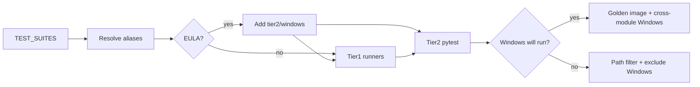

# Test Suites Filtering Redesign

<table>
<tr><td><b>Author</b></td><td>Ahmad Hafe</td></tr>
<tr><td><b>Status</b></td><td>In Review</td></tr>
<tr><td><b>Feature PR</b></td><td><a href="https://github.com/openshift-cnv/ocp-virt-validation-checkup/pull/116">#116</a></td></tr>
<tr><td><b>Bug</b></td><td><a href="https://redhat.atlassian.net/browse/CNV-100623">CNV-100623</a></td></tr>
</table>

---

## Summary

Redesign `TEST_SUITES` so users select coverage by **tier** and **SIG**, instead of a flat list where `storage` means only KubeVirt Tier-1 and `tier2` is one opaque blob.

Shared parsing lives in [`scripts/test-suites.sh`](https://github.com/openshift-cnv/ocp-virt-validation-checkup/blob/feat/test-suites-filtering/scripts/test-suites.sh) and is used by `generate`, `entrypoint`, and Tier-2.

## Motivation

Today `TEST_SUITES=storage` runs only KubeVirt Tier-1 storage. It does not run openshift-virtualization-tests storage coverage. Windows is also not a suite — it is a side effect of golden-image availability inside `tier2`.

### User Stories

As a storage partner, I want to choose Tier-1 storage, Tier-2 storage, or both.

As a partner validating Windows, I want a dedicated Windows suite filter without taking the entire Tier-2 blob.

## Goals

- Tier1 / Tier2 selection with SIG-level granularity
- Tier2 mapped to OVT module paths; Windows as a first-class Tier-2 filter
- Backward-compatible aliases for today’s flat values
- Docs that show which repo and filter each suite runs

---

## Suite model

| Tier | Suite | What runs |
|------|-------|-----------|
| Tier1 | `tier1/compute` | KubeVirt `sig-compute` |
| Tier1 | `tier1/network` | KubeVirt `sig-network` |
| Tier1 | `tier1/storage` | KubeVirt `sig-storage` + `StorageCritical` |
| Tier1 | `tier1/ssp` | ssp-operator tests |
| Tier2 | `tier2/compute` | OVT `tests/virt/` + `conformance` |
| Tier2 | `tier2/storage` | OVT `tests/storage/` + `conformance` |
| Tier2 | `tier2/network` | OVT `tests/network/` + `conformance` |
| Tier2 | `tier2/infrastructure` | OVT `tests/infrastructure/` + `conformance` |
| Tier2 | `tier2/windows` | `conformance` + `windows` (golden-image gated) |

There is **no** `tier1/windows`. Windows is Tier-2 only.

### Syntax

```bash
TEST_SUITES=tier1/<sig>,tier2/<sig>,...
```

```bash
TEST_SUITES=tier1/storage
TEST_SUITES=tier1/storage,tier2/storage
TEST_SUITES=tier2/windows
TEST_SUITES=tier1/storage,tier2/storage,tier2/windows
```

### Flow



---

## Windows and Accept EULA

The UI **Accept Windows EULA** control sets `ACCEPT_WINDOWS_EULA=true`:

- Always adds `tier2/windows`
- Triggers golden-image setup when Windows is selected
- Windows-only without a golden image **fails** (no green empty run)
- When Windows runs together with path SIGs, path filters are cleared so Windows tests outside those modules are not dropped

| Input | Behavior |
|-------|----------|
| default suites + EULA | Windows included via legacy `tier2` |
| `tier2/windows` + EULA | Windows setup + Windows tests |
| `tier2/storage` + EULA | Resolves to `storage,windows` |
| `tier1/storage` + EULA | Adds `tier2/windows` |
| `tier2/storage` without EULA | Storage only |
| `tier2/windows` without image | Error |

---

## Backward compatibility

| Legacy value | Resolves to |
|--------------|-------------|
| `compute` / `network` / `storage` / `ssp` | `tier1/<same>` |
| `tier2` | all Tier2 SIGs (unrestricted OVT modules) |
| default `compute,network,storage,ssp,tier2` | same coverage as today |

`storage` stays Tier-1 only. Full storage coverage: `tier1/storage,tier2/storage`.

---

## Risks and mitigations

| Risk | Mitigation |
|------|------------|
| Flat suite names in existing jobs | Keep aliases; warn on bare names when Tier2 was not also selected |
| Windows + path SIGs under-collect | Clear path filters when Windows will run |
| Windows-only with no image | Hard fail with a clear message |
| Malformed lists (`tier1/compute,`) | Reject leading / trailing / duplicate commas |
| OVT module layout drifts | One path map in `scripts/test-suites.sh` |

---

## Related

- Feature PR: [#116](https://github.com/openshift-cnv/ocp-virt-validation-checkup/pull/116)
- Bug: [CNV-100623](https://redhat.atlassian.net/browse/CNV-100623)
- Code: `scripts/test-suites.sh`, `scripts/entrypoint.sh`, `scripts/tier2/test-tier2.sh`, `manifests/run/generate.sh`
